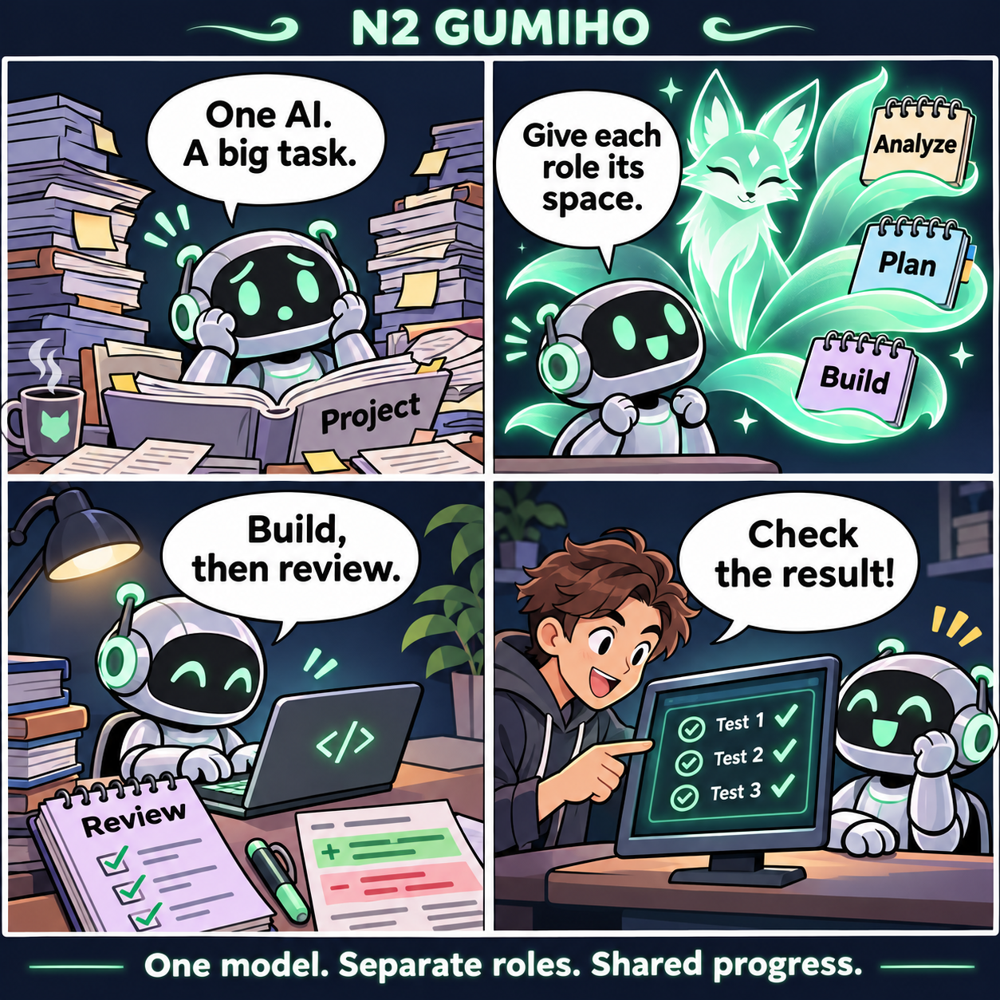
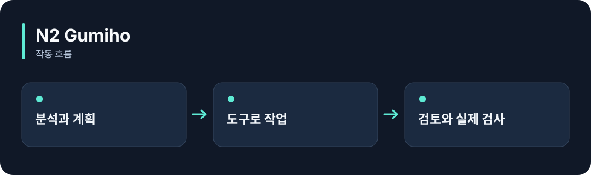

# N2 Gumiho

**AI 하나에도 분석·계획·실행·검토 역할을 맡겨, 일을 단계별로 진행하게 합니다.**

[](https://github.com/choihyunsus/n2-gumiho/releases/tag/v1.0.1) [](https://github.com/choihyunsus/n2-gumiho/blob/main/docs/reference.ko.md) [](https://github.com/choihyunsus/n2-gumiho/blob/main/LICENSE)

[English](README.md)

<p align="center">
  
</p>

AI 하나에게 큰 작업을 맡기고 → 역할별 작업 공간을 나눠 → 구현과 검토를 진행하고 → 실제 결과를 검사합니다.

기능을 이야기로 표현한 만화입니다. 실제 앱 화면은 아닙니다.

<details>
<summary>동작 흐름 펼쳐 보기</summary>



</details>

## 이런 때 사용하세요

기능 하나를 만들 때 먼저 관련 파일을 살펴보고, 계획을 세운 뒤 수정하고 결과를 검토하는 흐름에 활용하세요.

꼬리는 역할별 작업 공간을 뜻합니다. 하나의 모델 연결을 여러 꼬리가 사용할 수 있습니다. 파일 도구와 실제 테스트 명령은 연결한 앱이 제공합니다.

## 처음 실행하기

터미널에서 `node --version`을 실행해 Node.js 22 이상인지 확인하세요. 아래 명령은 새 연습 폴더를 만들고 GitHub 배포 파일을 설치합니다. 예제 파일과 DB도 이 폴더에 두면 경로를 따라가기 쉽습니다.

```sh
mkdir n2-gumiho-demo
cd n2-gumiho-demo
npm init -y
npm install https://github.com/choihyunsus/n2-gumiho/releases/download/v1.0.1/n2-gumiho-1.0.1.tgz
```

설치 중 SQLite 빌드 오류가 나오면 운영체제에 맞는 C/C++ 빌드 도구가 필요할 수 있습니다. 자세한 환경 조건은 [설치 참고](https://github.com/choihyunsus/n2-gumiho/blob/main/docs/reference.ko.md)에 있습니다.

이 예제는 준비된 연습용 응답을 사용해 실제 파일을 만들고 내용까지 검사합니다. 모델 계정 없이 작업 흐름을 먼저 확인할 수 있어요.

```sh
mkdir workspace
npx --no-install n2-gumiho run --adapter ./node_modules/n2-gumiho/examples/file-task.cjs --db ./demo.db --workspace ./workspace --project demo --agent assistant --run-id first-run --task "Create the demonstration file"
```

`workspace/gumiho-demo.txt`가 만들어지고 성공 결과가 표시됩니다. 실제 모델 연결 방법은 아래 상세 안내의 로컬 모델 연결에서 확인하세요.

## Soul과 함께 쓰기

여러 N2 모듈을 연결할 때 같은 `mimir.db` 파일을 지정하세요. `project`는 작업 이름, `agent`는 계속 사용할 AI 이름입니다. 같은 작업의 기록을 이어 쓰려면 이 값들을 맞춥니다. 단독 사용도 같은 필드 구조를 사용합니다.

## 다음 단계와 상세 안내

[전체 사용 안내](https://github.com/choihyunsus/n2-gumiho/blob/main/docs/reference.ko.md)에서 실제 앱 연결, API, 지원 범위, 복구 절차와 검증 범위를 확인할 수 있습니다. [배포 파일](https://github.com/choihyunsus/n2-gumiho/releases/tag/v1.0.1)에는 설치할 버전과 변경 설명이 있습니다.

처음 나오는 용어는 이렇게 읽으면 됩니다. **MCP**는 AI 앱의 도구 연결 방식, **DB**는 저장 파일, **호스트**는 이 모듈을 연결해 실행하는 앱입니다.

사용·재배포 조건은 [라이선스](https://github.com/choihyunsus/n2-gumiho/blob/main/LICENSE)를 확인하세요. 의존 모듈에는 별도 조건이 적용될 수 있으며, 상업 이용 조건은 상세 안내에 함께 설명되어 있습니다.
