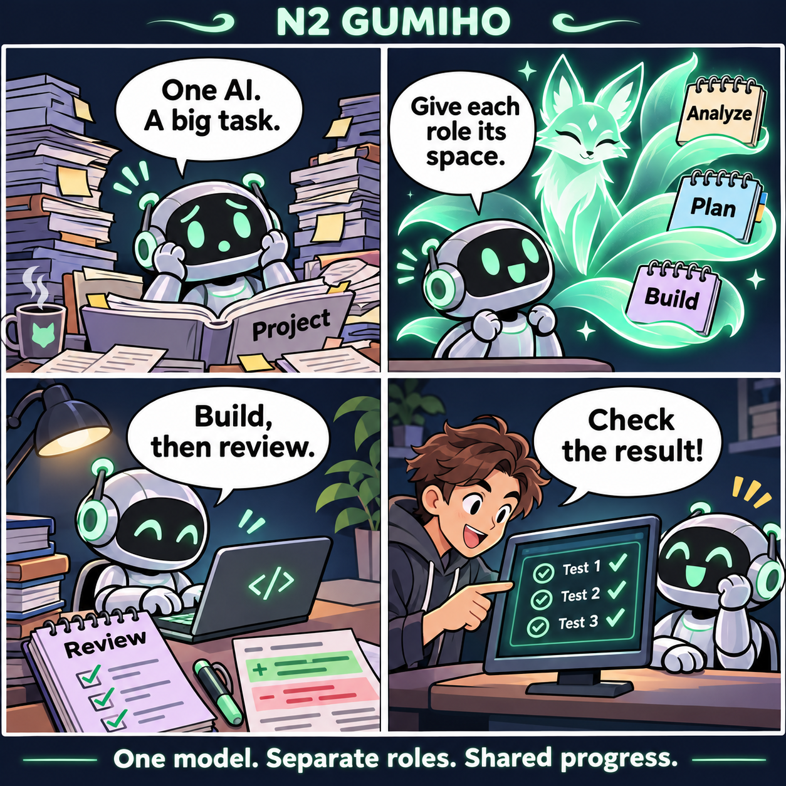
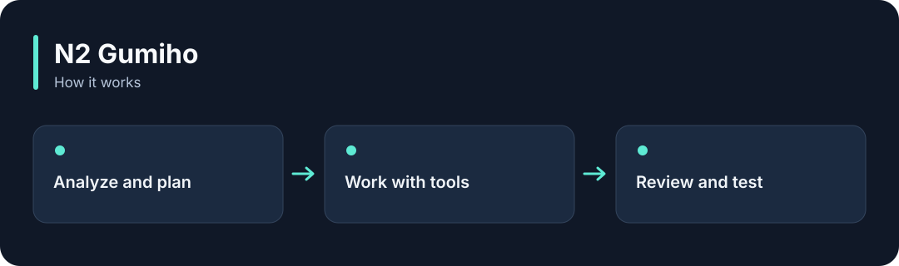

# N2 Gumiho

**Give one AI separate analysis, planning, implementation and review roles to work through a task.**

[](https://github.com/choihyunsus/n2-gumiho/releases/tag/v1.0.1) [](https://github.com/choihyunsus/n2-gumiho/blob/main/docs/reference.md) [](https://github.com/choihyunsus/n2-gumiho/blob/main/LICENSE)

[한국어](README.ko.md)

<p align="center">
  
</p>

Give one AI separate analysis, planning, implementation and review roles to work through a task.

A story illustrating the feature, rather than a screenshot of the app.

<details>
<summary>View the workflow</summary>



</details>

## When to use it

For a feature request, inspect the relevant files, plan the change, implement it and review the result.

A tail is a separate working context for a role. Several tails can use one model connection. The connected app supplies file tools and real test commands.

## Try it

Run `node --version` in a terminal and check for Node.js 22 or later. These commands create a fresh practice folder and install the GitHub release. Keep the example file and database in this folder.

```sh
mkdir n2-gumiho-demo
cd n2-gumiho-demo
npm init -y
npm install https://github.com/choihyunsus/n2-gumiho/releases/download/v1.0.1/n2-gumiho-1.0.1.tgz
```

If installation reports a SQLite build error, you may need your platform’s C/C++ build tools. See the [installation reference](https://github.com/choihyunsus/n2-gumiho/blob/main/docs/reference.md) for platform requirements.

This example uses prepared demo responses to create and check a real file. You can inspect the workflow before configuring a model account.

```sh
mkdir workspace
npx --no-install n2-gumiho run --adapter ./node_modules/n2-gumiho/examples/file-task.cjs --db ./demo.db --workspace ./workspace --project demo --agent assistant --run-id first-run --task "Create the demonstration file"
```

`workspace/gumiho-demo.txt` is created and the result reports success. Continue with the local-model section in the reference to connect a real model.

## Using it with Soul

Point connected N2 modules at the same `mimir.db` file. `project` names the work and `agent` names the AI identity you will keep using. Match those values to continue working with the same records. Standalone use follows the same field layout.

## Next steps and reference

The [full reference](https://github.com/choihyunsus/n2-gumiho/blob/main/docs/reference.md) covers app integration, APIs, supported features, recovery and validation. The [release page](https://github.com/choihyunsus/n2-gumiho/releases/tag/v1.0.1) contains the installable version and release notes.

A few terms used in the reference: **MCP** connects tools to an AI app, a **database** stores records, and the **host** is the app that connects and runs this module.

Review the [license](https://github.com/choihyunsus/n2-gumiho/blob/main/LICENSE) for use and redistribution. Dependencies can have their own terms, including commercial-use conditions described in the reference.
